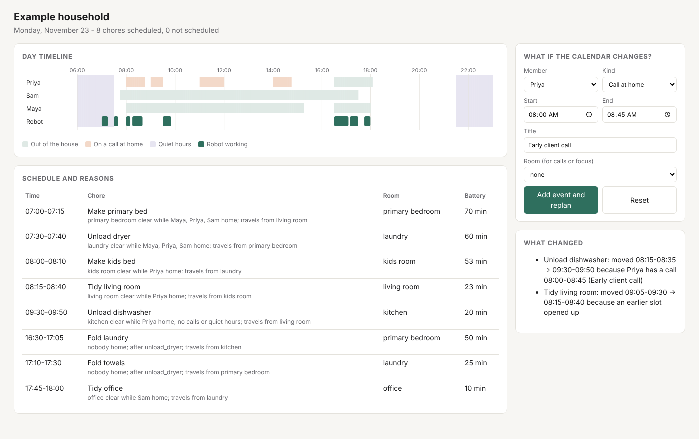

# homesched

Calendar- and presence-aware chore scheduling for a household robot.

A home robot that folds laundry and makes beds has a scheduling problem that a
factory robot does not: the "work cell" is full of people whose plans change
every day. It should not make a bed while someone is asleep in it, run the
dishwasher unload during a parent's customer call, or start folding towels
twenty minutes before its battery dies. `homesched` takes a household's
calendars, routines and chore list and produces a day plan for one robot that
respects those constraints, explains every placement, and replans with a
readable diff when the calendar changes.



> Independent project. Not affiliated with or endorsed by Syncere. It is
> built around the publicly described behavior of Syncere's Lume robot and
> app (chore assignment from the app, a safety lock when people or pets are
> nearby, learned folding preferences) and is meant as a concrete proposal,
> not a claim about how their product works internally.

## Why this, for Syncere

Syncere's app already lets a household assign chores to the robot, and the
robot already refuses to act when someone is close. Those two pieces leave a
gap: *when* should an assigned chore actually run? Today that is either "now"
or a time the user picks. The household already has the information needed to
answer it automatically, in their calendars:

- Who is out of the house, and when (work, school, practice).
- Who is home but on a call, where noise matters.
- Who is in which room at which hour (sleeping, working from the home office).

Using that information turns the safety lock from something the robot runs
into mid-task into a constraint the plan avoids in the first place, and lets
the robot do most of its work while nobody is home, which is when owners most
want it to happen.

## What it does

**Hard constraints**, never violated:

| Constraint | How it is modeled |
| --- | --- |
| Time windows | Each chore has an earliest start and a deadline. |
| Dependencies | `after: ["unload_dryer"]` means folding cannot start until unloading finishes. Cycles are rejected. |
| One robot | No overlapping chores; moving between rooms costs travel time. |
| Safety | Chores marked `requires_empty_room` never overlap anyone being in that room. |
| Noise | Loud chores never run during quiet hours or while anyone at home is on a call. |
| Battery | Work drains the battery, idle time on the dock recharges it, and a reserve is always kept for the trip back. |

**Soft preferences**, scored among feasible start times: run while nobody is
home, finish sooner, and avoid extra travel.

**Explanations.** Every scheduled chore carries the reasons it landed where
it did (`nobody home; after unload_dryer; travels from kitchen`), and every
chore that could not be placed says why (`no feasible slot between 08:00 and
09:00: bedroom occupied (A)`). A schedule a family cannot understand is a
schedule they will override by hand.

**Replanning with a diff.** When an event is added, the plan is recomputed
and compared with the old one. Each moved chore names the calendar event that
caused the move:

```
Unload dishwasher: moved 08:15-08:35 -> 09:30-09:50 because Priya has a call 08:00-08:45 (Early client call)
Tidy living room: moved 09:05-09:30 -> 08:15-08:40 because an earlier slot opened up
```

This is the message a phone notification would carry.

**Calendar import.** `.ics` files (exported from any calendar) and an optional
Google Calendar adapter with a read-only scope. Events are classified
automatically: a video-conference link or words like "standup" or "1:1" with no
physical location mean a call at home; a street address means the person is
out; "home" or "WFH" in the location means they are home and busy in a room.
All-day events are ignored.

## Quick start

Requires Python 3.11 or newer.

```bash
python -m venv .venv && source .venv/bin/activate
pip install -e ".[dev]"

homesched plan examples/household.json
homesched whatif examples/household.json --add "Priya,meeting,08:00,08:45,Early client call,office"
homesched serve examples/household.json     # http://127.0.0.1:8000
```

Output of `homesched plan` on the example household (two working parents, one
working from home with three calls, a child at school then swim practice):

```
time         chore                 room              battery  why
07:00-07:15  Make primary bed      primary bedroom      70m  primary bedroom clear while Maya, Priya, Sam home; travels from living room
07:30-07:40  Unload dryer          laundry              60m  laundry clear while Maya, Priya, Sam home; travels from primary bedroom
08:00-08:10  Make kids bed         kids room            52m  kids room clear while Priya home; travels from laundry
08:15-08:35  Unload dishwasher     kitchen              28m  kitchen clear while Priya home; no calls or quiet hours; travels from kids room
09:05-09:30  Tidy living room      living room          10m  living room clear while Priya home; travels from kitchen
16:30-17:05  Fold laundry          primary bedroom      50m  nobody home; after unload_dryer; travels from living room
17:10-17:30  Fold towels           laundry              25m  nobody home; after unload_dryer; travels from primary bedroom
17:45-18:00  Tidy office           office               10m  office clear while Sam home; travels from laundry
```

Note what the planner did on its own: the beds are made right after people
leave them, the loud dishwasher unload finishes before Priya's 09:00 standup, folding is
pushed to the one window where the house is empty, and the robot charges
through the middle of the day because Priya is home and in calls.

### Using real calendars

```bash
# .ics export from any calendar app
homesched plan examples/household.json --ics Priya=priya.ics --work-room Priya=office

# Google Calendar (read-only); needs an OAuth client file from Google Cloud
pip install -e ".[google]"
python -c "from homesched.calendars import load_google; print(load_google('primary', 'Priya', __import__('datetime').date.today(), 'America/New_York'))"
```

`--work-room` says which room a member is in during calls at home, so the
planner can still clean other rooms during that call.

## Household file

A household is a JSON document validated by Pydantic (`homesched/model.py`).

```jsonc
{
  "day": "2026-11-23",
  "quiet_start": "21:30", "quiet_end": "07:30",
  "rooms": ["living room", "kitchen", "primary bedroom", "kids room", "office", "laundry"],
  "members": [
    { "name": "Priya", "default_room": "living room",
      "rules": [{ "room": "primary bedroom", "start": "22:30", "end": "06:45" },
                { "room": "office", "start": "08:30", "end": "16:30" }] }
  ],
  "events": [
    { "member": "Priya", "title": "Team standup", "kind": "meeting", "room": "office",
      "start": "2026-11-23T09:00", "end": "2026-11-23T09:30" }
  ],
  "chores": [
    { "id": "fold_laundry", "name": "Fold laundry", "room": "primary bedroom",
      "duration_min": 35, "earliest": "07:30", "deadline": "21:00",
      "priority": 3, "noise": "quiet", "requires_empty_room": true,
      "after": ["unload_dryer"] }
  ],
  "robot": { "dock_room": "living room", "battery_work_min": 90,
             "charge_rate": 0.5, "travel_min": 3, "reserve_min": 10 }
}
```

Member `rules` describe routines (asleep in the bedroom overnight, in the
office during work hours); calendar `events` override them for specific times.
Windows that cross midnight are supported.

## How it works

```
homesched/
  model.py       Pydantic models for households, chores, events and plans; cross-field validation
  occupancy.py   Expands routines and calendar events into 5-minute slots: who is home, in which room, on a call
  scheduler.py   Constraint checks, scoring, greedy placement, explanations
  diff.py        Compares two plans and attributes each move to a new calendar event
  calendars.py   .ics import, Google Calendar adapter, event classification
  cli.py         plan / whatif / serve
  web.py         FastAPI app: GET /api/plan, POST /api/events, POST /api/reset
  static/        Single-page timeline view (no build step)
```

The scheduler orders chores by priority and deadline with dependencies first,
then for each chore evaluates every start slot in its window against the hard
constraints and keeps the highest-scoring feasible one. After each placement
it recomputes travel along the robot's actual route, since inserting a chore
between two others changes where the robot is coming from. Battery feasibility
is checked over the whole timeline, not just locally, because a chore placed
early in the day reduces the charge available to every chore after it.

Greedy placement is a deliberate choice for this size of problem (a household
has tens of chores, not thousands): it is fast enough to rerun on every
calendar change, and its decisions are easy to explain one at a time. The
obvious next step is a local-search pass or a CP-SAT model when a high-priority
chore is left unscheduled that a different ordering would fit.

## Tests

```bash
pytest          # 25 tests
ruff check . && ruff format --check .
```

The tests check every hard constraint against the example household (no
chore runs in an occupied room, no overlaps, travel always fits, dependencies
hold, battery never drops below reserve), plus targeted cases: loud chores
waiting out a call, battery forcing a charging break, chores that cannot be
placed reporting why, dependents of unplaceable chores, replan attribution,
calendar classification, `.ics` import with time zones and all-day events, and
the web API.

## Limitations and next steps

- One robot. Multiple robots would turn this into a small vehicle-routing
  problem with shared rooms.
- Presence comes from calendars and routines. A real deployment would fuse
  this with the robot's own occupancy sensing and phone geofencing, and
  replan when they disagree with the calendar.
- Chore durations are fixed. Learning them from the robot's history (the same
  way folding preferences are learned) would tighten the plan.
- Pets are not modeled separately; they could be added as members with
  routines and no calendar.

## License

MIT
